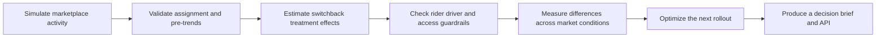

# Equilibrium Lab

**A practical way to evaluate product changes in a two-sided marketplace.**

I built Equilibrium Lab to go beyond the question: “Did the main metric improve?”

In a marketplace, a product change can affect riders and drivers differently. An increase in completed trips may look positive, but it could also lead to longer pickup times, lower driver earnings or worse availability in certain areas.

The project simulates a new matching policy across multiple geographic zones using a switchback experiment. It measures:

- Completed-trip conversion
- Rider pickup times and cancellations
- Driver utilization and earnings
- Marketplace efficiency
- Differences across demand levels and neighborhood access groups

The goal is to understand whether the policy creates value across the marketplace and then make a clear recommendation to scale it gradually, improve it, or stop the rollout.


## The questions

- Did the matching policy improve completed trips without harming marketplace health?
- Were gains caused by the policy or by time-of-day and zone differences?
- Did riders and drivers both benefit?
- Were improvements shared across neighborhoods and demand conditions?
- Which zones should receive the policy next?

## What makes this project different

- Uses a **zone bytime switchback design** to reduce interference between treatment and control.
- Estimates effects with **cluster uncertainty** instead of treating every event as independent.
- Runs **sample-ratio and pre-trend checks** before interpreting results.
- Measures both sides of the marketplace through rider, driver and system guardrails.
- Reports **heterogeneous effects** by demand pressure and neighborhood access level.
- Uses a constrained optimizer to recommend rollout while protecting minimum service coverage.
- Keeps the statistical evidence separate from the final product decision.


## Run the project

```bash
python -m venv .venv
source .venv/bin/activate
pip install -e '.[dev]'
streamlit run streamlit_app.py
```

You can also run the analysis directly:

```bash
python -m equilibrium_lab.cli --seed 29 --zones 18
```

## How the analysis flows



## Repository map

| Location | What it does |
|---|---|
| `src/equilibrium_lab/simulation.py` | Creates realistic zone-by-hour marketplace data. |
| `src/equilibrium_lab/experiment.py` | Estimates switchback effects with cluster-robust uncertainty. |
| `src/equilibrium_lab/diagnostics.py` | Checks assignment balance, pre-trends, and marketplace guardrails. |
| `src/equilibrium_lab/optimizer.py` | Recommends where to expand the policy next. |
| `src/equilibrium_lab/analysis.py` | Combines the evidence into a product recommendation. |
| `src/equilibrium_lab/api.py` | Makes the analysis available to the dashboard. |
| `streamlit_app.py` | Contains the interactive marketplace decision brief. |
| `tests/` | Verifies the simulation, statistics, optimizer, and API. |
| `docs/` | Explains the methodology and interview narrative. |
